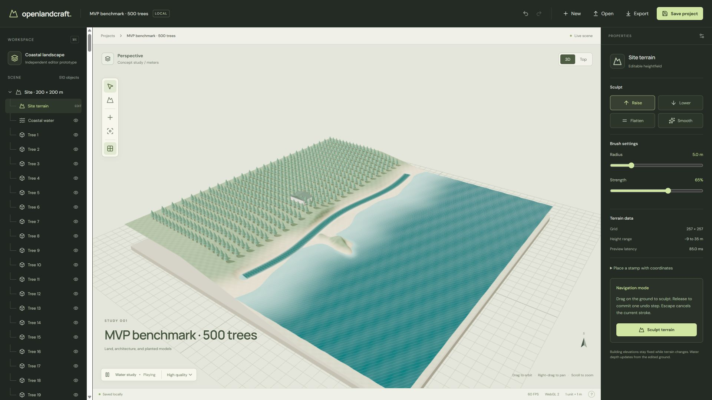
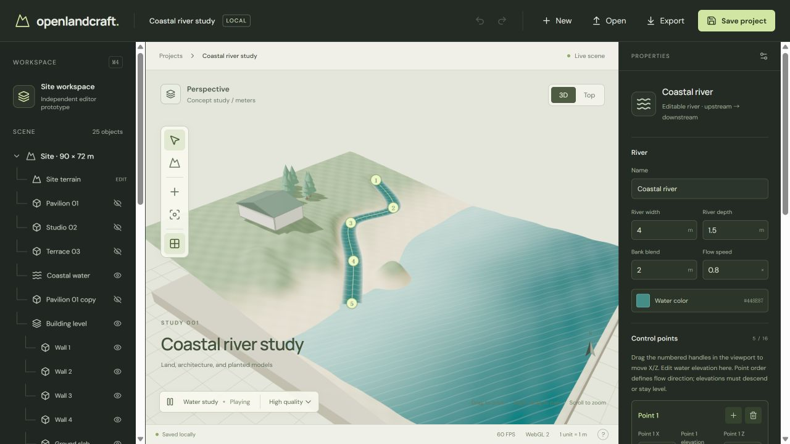

# M4 complete MVP validation

Recorded October 17, 2026. The bounded manual workflow is implemented and validated below. This is a prototype validation record; browser-profile portability and broader hardware coverage remain open release checks.

## Changes made during validation

- Added New site with 20–200 m dimensions, coast or flat ground, and 129² or 257² samples. Creating a site is undoable within the session. Rename is undoable and updates the browser title. Both dialogs support keyboard focus containment and fit a 375 px viewport.
- Made starter rivers, buildings, and model placement respect smaller site dimensions. River creation is tested on square and extreme rectangular sites.
- Added a recovery banner when local hydration fails. Autosave stays paused until the user explicitly saves, opens a valid project, or creates a new site. Imports validate before replacement and show loading feedback; failed model placement no longer produces a success notification.
- Paused autosave scheduling during active previews. Save/export continue to use committed state only.
- Batched eligible repeated GLB meshes with instance-ID picking. Skinned, morphing, transparent, mirrored, and non-mesh content uses the individual-object fallback. Model source geometry/material/texture ownership remains shared.
- Replaced full terrain triangle picking with grid-cell traversal, reused geometry/color buffers, and updated normals around changed samples. Memoized scene rows and removed full-document stringification from terrain commits.
- Scaled large-site camera/grid/shadow settings and enabled left-drag pan in Top view. Water playback is disabled when the scene has no visible water.

## Acceptance evidence

| PRD criterion | Evidence and result |
| --- | --- |
| New site without an account | Browser-created 40 × 30 m flat site, then added river, building, and tree. New-site undo restored the entire 500-tree benchmark; redo restored the small site. Core tests cover 129²/257² grids, dimensions, resolution changes, and invalid replacements. Pass. |
| Four terrain brushes, undo/redo | M1 browser checks cover raise/lower/flatten/smooth. M4 integration applies all four to one project and verifies each changes heights and reverses exactly. Terrain picking and local normal updates are compared against Three.js geometry. Pass within the bounded workflow. |
| River handles update ground and water; undo restores both | M3 browser drawing/handle/numeric checks and river geometry tests, plus M4 integrated river edits and full undo/redo. Pass. |
| Removing river retains independent sculpting | M3 browser checks and M4 integration compare restored terrain to the authored field. Carving remains derived. Pass. |
| GLB place/select/move/rotate/scale/save/reopen | M2 browser import and transform checks; M4 clicked a batched tree in the viewport, set rotation 45° and Y scale 1.5, then reloaded and verified both values and the source. Full workflow tests preserve exact embedded bytes. Pass. |
| Building and landscape remain independently editable | M2/M3 browser checks and M4 small-site creation. Integration combines a seven-part building, terrain edits, trees, and river, then reverses/replays the complete history. Pass. |
| Portable export/import into a fresh browser context | M2 verified browser file export/open; M4 serializes/deserializes the combined scene, deletes the fake IndexedDB database, and reopens identical parameters, heights, and source bytes. Browser reload is verified separately. A genuinely isolated browser profile/context was unavailable in this tool session, so that exact manual release check remains open. |
| Cancel leaves no partial edit/history | Existing core and M1/M3 browser preview/cancel checks, plus M4 integrated cancellation and invalid-replacement draft preservation. Pass for exercised gestures; native pointer-loss scenarios retain the existing handlers and are not an exhaustive device matrix. |
| Invalid data is readable and preserves the scene | M3 malformed-file browser checks; schema, invalid-save, and new-site replacement tests. M4 injects corrupt local data in fake IndexedDB, verifies loading rejects without changing the stored bytes, then verifies explicit save recovery. The App's recovery banner/resume branches were reviewed; real browser quota/permission failures were not injected. |

The checked controls include scene visibility, selection, numeric previews/apply/cancel, history, site creation/rename, placement/scatter, building/river creation, water pause/quality, framing, and plan navigation. Historical browser records remain linked below rather than claiming every M0–M3 check was repeated in M4.

## Performance evidence

Benchmark generator: `node scripts/create-mvp-benchmark.mjs`. It writes `.qa/mvp-benchmark.olc.json`; open that file through the editor. Its separate Node timing excludes browser rendering and must not be used as the brush-feedback measurement.

- Windows, embedded Chromium browser, WebGL 2, ANGLE Intel Arc with Direct3D 11. Exact CPU/GPU model, browser build, and an agreed reference-machine specification were not established.
- 1920 × 1080 viewport, High quality, DPR capped at 1.5, water playing, grid and shadows enabled.
- 200 × 200 m, 257 × 257 heights, one 16-point river, one seven-part building, one ocean, 500 original demo-tree instances sharing one 7,652-byte GLB with two mesh primitives. Total 509 entities plus terrain.

| Measurement | Initial M4 implementation | Final implementation |
| --- | --- | --- |
| Observed navigation/idle FPS | About 40 | About 52–60 |
| Brush feedback, first/latest samples | 167.1 ms | 93.7, 96.3, 85.0 ms |
| Draw calls in captured view | 1,488 | 27 |
| Submitted triangles in captured view | 234,392 | 258,242 |

The status reports approximately 40 FPS during the sampled strokes. Triangle counts rise because a visible instance batch submits more off-screen members than individually culled meshes. Counts are camera-dependent. Feedback uses the editor's pointer-to-next-frame instrumentation, not an external input-to-display measurement. These are a few observed samples, not a latency percentile or a guarantee for all assets. Some intermediate versions exceeded 100 ms; the final sampled strokes were below it. The provisional 30 FPS/100 ms targets were met in this session, but are not yet general release gates.

## Reproducible checks

`npm test`: **54 tests pass across 13 files**. Coverage includes schema migration, exact terrain undo, river validation/carving, model source preservation, building relationships, grid picking, instance fallback/selection mapping, localized normals, new-site replacement, corrupt-storage recovery, and the combined workflow in fresh fake IndexedDB.

`npm run build`: TypeScript checking and Vite production build pass. Vite reports a large main bundle: approximately 1.44 MB minified / 399 KB gzip. Code splitting remains future loading work; it does not invalidate the build.

A fresh localhost browser tab hydrated the full example with **no captured console errors**. The saved courtyard separately reopened with its name, dimensions, entities, model rotation, and nonuniform scale intact. Browser QA used `localhost:5173`; the user's `127.0.0.1:5173` storage was untouched and their server was left running.

## Deliverables and limits

Open [the coastal river example](../examples/coastal-river.olc.json) for the complete scene. [Usage and recovery](USAGE.md) covers operation and storage behavior. Earlier evidence: [M0](M0_VALIDATION.md), [M1](M1_VALIDATION.md), [M2](M2_VALIDATION.md), [M3](M3_VALIDATION.md).

Limits remain one current browser-local project, 100 session history entries, one bounded heightfield, one unbranched river, basic independent building parts, and self-contained uncompressed GLB files. No animation playback for imported models, fluid simulation, full BIM, or cloud collaboration. Existing file/source/entity size limits still apply. Large arbitrary models may need manual zoom after framing. Additional browser/GPU/device testing and the isolated-profile portability check are required before a wider release.
